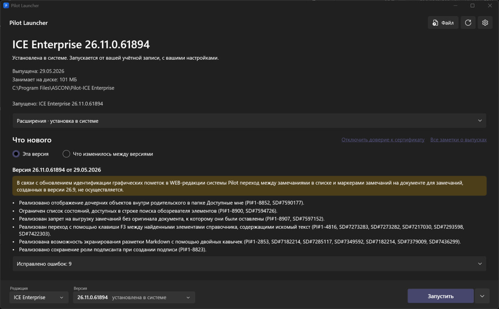

# PilotLauncher

Лаунчер версий Pilot. PilotLauncher скачивает версии из центра загрузок, распаковывает их без установки и запускает рядом друг с другом, каждую со своими настройками.

Редакции: ICE Enterprise, ICE, BIM, ECM, myAdmin. Источник версий: <https://pilot.ascon.ru/release/>.



## Возможности

- Список версий всех редакций, скачивание, распаковка без установки, запуск нескольких версий одновременно.
- Каждая версия работает в своём профиле: настройки, сохранённые логины и кэш не смешиваются.
- Версия, установленная в системе, определяется сама и запускается как раньше; её можно скопировать для запуска в отдельном профиле.
- Метка версии в заголовке окна запущенного Pilot.
- Избранные версии: звезда рядом с выбором версии поднимает версию в начало списка и помечает её.
- Заметки о выпуске: что нового в выбранной версии и что изменилось между двумя версиями.
- Расширения PilotLookUp и DynamoPilot: установка, обновление, удаление для конкретной версии, одна общая копия на все версии.
- Работа без интернета: установщики из файлов, папка с установщиками, скачивание zip для переноса на другой ПК.
- Установка выбранной версии в систему с заменой текущей.
- Установщик для одного пользователя и портативная версия, .NET на ПК не нужен.

## Установка

Требуется Windows x64 (Windows 10 1607 и новее или Windows 11; проверялось на Windows 11). Файлы лежат на странице Releases репозитория:

- `PilotLauncher-Setup.exe` ставит лаунчер в `%LOCALAPPDATA%\Programs\PilotLauncher` без прав администратора: ярлык в меню «Пуск», запись в «Приложения». Удаление там же или `PilotLauncher.exe --uninstall`; скачанные версии и настройки при этом не удаляются.
- `PilotLauncher-portable-win-x64.zip` содержит один exe и `portable.flag`, все данные лежат рядом с ним.
- `SHA256SUMS.txt` содержит контрольные суммы обоих файлов. Файлы не подписаны, поэтому Windows SmartScreen может предупредить при первом запуске.

## Как пользоваться

1. Выберите редакцию и версию внизу окна и нажмите «Запустить». Если версии нет на диске, лаунчер скачает её, распакует и запустит.
2. Версия, установленная в системе, помечена «установлена в системе» и запускается от вашей учётной записи, с вашими настройками.
3. Стрелка рядом с кнопкой открывает меню версии:
   - «Запустить в отдельном профиле» (если есть и системная версия, и копия);
   - «Поставить для отдельного пользователя»: копия системной версии для запуска в отдельном профиле, параллельно с основной;
   - «Открыть папку», «Создать ярлык на рабочем столе»;
   - «Установить в систему (заменить текущую)...», см. ниже;
   - «Удалить копию...»: удаляет версию, скачанную лаунчером, с вопросом, удалять ли данные версии (подключения, логины, кэш). Установка в системе не затрагивается;
   - «Удалить из системы...»: удаляет установленную в системе версию её деинсталлятором, с подтверждением и запросом Windows. Копия лаунчера остаётся. Если у версии есть и установка, и копия, каждую можно удалить отдельно.
4. Раздел «Что нового» показывает заметки о выпуске выбранной версии. Переключатель «Что изменилось между версиями» собирает выпуски между версией, выбранной внизу, и версией из списка «Сравнить с версией».
5. Блок «Расширения» ставит PilotLookUp и DynamoPilot в папку `Development` выбранной версии (подробнее ниже).
6. Пока клиенты запущены, закрытие окна сворачивает лаунчер в трей: он поддерживает метку версии в заголовках окон.

Если Pilot отдельного профиля предложит обновиться, откажитесь: обновление ставит служба PilotUpdater на весь компьютер и может заменить установленную в системе версию.

### Без интернета

Меню «Файл» в шапке окна:

- «Добавить из файла...»: один или несколько установщиков (`Pilot-...-setup_версия.zip` или `.exe`), либо перетащите файлы на окно. Редакция и версия определяются по имени файла или по самому exe, при неудаче лаунчер спросит. Ваши файлы не меняются и не удаляются.
- Папка с установщиками (настройки): при старте лаунчер ищет в ней файлы `Pilot-...-setup_версия.zip` и `.exe` (без вложенных папок) и показывает их версии как доступные без сети. Папка может быть на флешке.
- «Скачать для офлайна...»: скачивает zip выбранной версии в выбранную папку, без распаковки.

Список версий офлайн доступен, если лаунчер хотя бы раз был в сети (он хранит последний список); иначе остаются установленные, скопированные и офлайн-версии.

### Расширения

Блок под сведениями о версии ставит [PilotLookUp](https://github.com/mahach666/PilotLookUp) и [DynamoPilot](https://github.com/mahach666/DynamoPilot) из их последних релизов на GitHub. Кнопки: «Установить», «Обновить» (когда есть релиз новее), «Обновить все», «Удалить». После изменений перезапустите Pilot этой версии.

- Копия расширения одна на все версии: в `Development` каждой версии лежит только ссылка. DynamoPilot занимает около 540 МБ, но в хранилище он один. Сам DynamoPilot при первом запуске распаковывает свою оболочку (около 350 МБ) в `%LOCALAPPDATA%\DynamoPilot` каждого профиля, это лаунчер объединить не может.
- Если в `Development` уже есть папка с таким именем, сделанная не лаунчером (например, ваша отладочная копия), лаунчер её не трогает. Кнопка «Заменить» после подтверждения переносит её в `_replaced` рядом с хранилищем расширений и ставит ссылку.
- Версия расширения не привязывается к версии Pilot, ставится последний релиз. Совместимость со старыми клиентами лаунчер не проверяет.

### Общие папки

Версия, запущенная в отдельном профиле, работает под своим пользователем Windows и не видит ваши файлы: ни `Загрузки`, ни рабочий стол. Чтобы открыть файл в такой версии Pilot (например, загрузить модуль расширения), положите его в общую папку. Список таких папок: «Настройки» → «Общие папки».

- «Создать папку по умолчанию» делает папку `C:\Users\Public\Documents\Pilot Launcher` (в «Общих документах» Windows). Права ей выдавать не нужно, запрос Windows не появляется. Это самый простой вариант.
- «Добавить...» открывает изолированным версиям любую вашу папку (на чтение и изменение, вместе с вложенными). Windows один раз запросит подтверждение (права администратора). Нельзя открыть диск целиком, системные папки, `ProgramData`, папку профиля пользователя целиком, данные лаунчера и папку скачанных версий, а также сетевые папки и ссылки на папки.
- «Убрать» закрывает папку (файлы в ней не удаляются), «Открыть» показывает её в проводнике.
- Файл надо класть в общую папку **без запроса прав администратора** (обычным копированием из ваших папок). Файл, созданный с правами администратора, получает высокий уровень защиты, и изолированный Pilot не сможет открыть его для записи («Отказано в доступе»).
- Права получают только изолированные пользователи этого лаунчера (через группу `PilotLauncher-<метка>` на вашего пользователя Windows), другие пользователи ПК не затрагиваются.

### Установка в систему

«Установить в систему (заменить текущую)...» ставит выбранную версию настоящим установщиком на весь компьютер (клиент, драйвер виртуального диска Pismo, политика подписи драйверов, как при обычной установке). Доступно для версии, которой нет в системе: скачанной, ещё не скачанной (установщик загрузится из центра загрузок) или из файла установщика. Перед началом лаунчер показывает, что будет сделано, и просит подтверждение.

- Выбранная версия новее установленной: установщик заменяет её сам.
- Выбранная версия старше: пакет не позволяет понижение, поэтому сначала удаляется установленный клиент этой редакции, потом ставится выбранный.
- Затрагивается только клиент выбранной редакции. Если клиент этой редакции запущен (у любого пользователя), лаунчер предупреждает и ничего не делает.
- Установка идёт тихо и может занять несколько минут. При ошибке в сообщении указан путь к журналу в `%LOCALAPPDATA%\PilotLauncher\logs`.

## Как это устроено

- **Версии не устанавливаются.** Установщик Pilot (WiX Burn) не запускается: из zip достаётся exe, из него вырезается встроенный контейнер, из него MSI, и клиент распаковывается через `msiexec /a`. Скачанные и промежуточные файлы удаляются сразу, на диске остаётся только распакованный клиент.
- **Изоляция: отдельный пользователь Windows на версию.** Имя вида `plab12E26x13x62219` (владелец, редакция, версия), пароль случайный и хранится зашифрованным (DPAPI) только для вашей учётной записи. Пользователь обычный, не администратор, скрыт с экрана входа; свои `HKCU`, `%APPDATA%`, `%LOCALAPPDATA%` у каждой версии получаются сами. Подмена `APPDATA` в окружении версии не изолирует, поэтому выбраны отдельные пользователи.
- **Права администратора** нужны для создания и удаления такого пользователя, для установки в систему и для первого связывания профиля с папкой расширений. Лаунчер запускает свою копию с ключом `--admin`, Windows показывает запрос UAC. Копия принимает только свои команды: пользователей только своего формата, известные редакции и фиксированные пути.
- **Папка версий** по умолчанию `C:\ProgramData\PilotLauncher\versions` (меняется в настройках, только локальный диск). Остальные пользователи ПК могут запускать оттуда файлы, но не менять чужие. В ней же `.extensions` (общие копии расширений), `.profiles` (папки `Development` отдельных профилей) и `.tmp`.
- **Данные лаунчера:** `%LOCALAPPDATA%\PilotLauncher` (настройки, журнал `logs\launcher.log`, пароли профилей, кэши списка версий, заметок и релизов расширений); в портативной версии папка `data` рядом с exe.
- **Расширения.** Релиз скачивается с GitHub, проверяется по SHA-256 из ответа GitHub (если он есть) и распаковывается в `.extensions\<расширение>\<релиз>`. В `Development` версии создаётся junction (ссылка на папку, права администратора не нужны); Pilot открывает её как обычную папку, это проверено на живом клиенте 26.11. Релиз удаляется, когда на него не осталось ссылок. Для системной установки ссылки лежат в вашем `%LOCALAPPDATA%\ASCON\<продукт>\Development`, для отдельного профиля в `.profiles\<пользователь>\Development`, а профиль один раз связывается с этой папкой (запрос UAC). Ответ GitHub хранится с ETag и считается свежим 6 часов, кнопка обновления в шапке спрашивает сразу.
- **Заметки о выпуске** берутся со страницы <https://help.pilotems.com/ru/Content/RelNotes.htm> (сервер не отдаёт `ETag`, поэтому копия считается свежей сутки). Редакции ICE Enterprise, ICE и ECM читают строки «Pilot-ICE Desktop», BIM читает «Pilot-BIM Desktop», myAdmin читает «Pilot-myAdmin Desktop». Версия ищется точно, а если её нет, по первым трём или двум числам при единственном совпадении.
- **Сертификат help.pilotems.com.** Сайт отдаёт сертификат удостоверяющего центра Минцифры (Russian Trusted Root CA), которому Windows по умолчанию не доверяет. Тогда под предупреждением появляется кнопка «Установить»: она включает доверие этому корню только внутри лаунчера и только для help.pilotems.com, в Windows ничего не устанавливается. Корень встроен в программу (`src/PilotLauncher.Core/Net/russian_trusted_root_ca.crt`, источник <https://gu-st.ru/content/lending/russian_trusted_root_ca_pem.crt>, SHA-256 `D26D2D0231B7C39F92CC738512BA54103519E4405D68B5BD703E9788CA8ECF31`, действует до 28.02.2032) и при запуске сверяется с этим отпечатком. Отозвать доверие можно ссылкой в разделе «Что нового». Отзыв сертификата не проверяется.

Режимы командной строки: `--launch <IceEnterprise|Ice|Bim|Ecm> <версия>` (запускают ярлыки), `--install`, `--uninstall`, `--admin ...` (служебный, вручную не вызывать).

## Ограничения

Что не проверялось на живом ПК (подробности в [docs/design.md](docs/design.md)):

- создание пользователя Windows и запуск клиента под ним, связывание профиля с папкой расширений;
- установка в систему с заменой текущей (автотесты работают на подменённых реестре и запуске программ), особенно понижение версии: пробовать на тестовой машине;
- установщики ICE, BIM, ECM и версий 15.x-25.x: заголовки совпадают с проверенными, содержимое не смотрели; имена исполняемых файлов и ключей реестра для ICE и ECM выведены по аналогии с BIM и Enterprise;
- поведение клиента при согласии на обновление в изолированном профиле, метка версии в окне клиента под другим пользователем.

Остальное:

- Только Windows x64. Для первого запуска версии в отдельном профиле нужны права администратора от той же учётной записи, под которой запущен лаунчер.
- Если на одном ПК работают два пользователя Windows, у каждого свои профили (`plab12...` и `plcd34...`): пароль привязан к создавшему профиль пользователю Windows.
- Целостность скачанных установщиков Pilot и их подпись не проверяются (на сервере лежат отчёты `gost_hash_report_*.txt`, их можно использовать).
- Заметки выпусков 2024 года: часть исправлений не названа по продукту, в разделе показано только их число. Заметок до версии 24.1 на странице нет.
- Серверные пакеты Pilot и подключения к базам лаунчер не трогает.

## Если что-то пошло не так

- Журнал: `%LOCALAPPDATA%\PilotLauncher\logs\launcher.log`.
- Профиль версии остался после сбоя: `net user` в консоли администратора покажет пользователей `pl...`; лишнего можно удалить командой `net user <имя> /delete` и папкой `C:\Users\<имя>`.
- «Удалить копию...» с галочкой «удалить также данные» сообщает «Копия удалена, но данные версии остались»: копия удалена, а временный пользователь Windows и его профиль нет (Windows держит профиль открытым, хотя окон Pilot уже нет, или вы отклонили запрос Windows). Ничего не потеряно: при повторной загрузке этой версии пользователь используется снова. Помогает перезагрузка Windows и удаление вручную, как в пункте выше; имя пользователя названо в сообщении.

## Сборка

```powershell
dotnet build PilotLauncher.sln
dotnet test PilotLauncher.sln                  # интеграционные тесты пропускаются, если нет установщиков Pilot
powershell -ExecutionPolicy Bypass -File build\publish.ps1    # artifacts\: Setup.exe, portable zip, SHA256SUMS.txt
```

Опциональная проверка с настоящим GitHub (скачивает около 3,5 МБ во временную папку):

```powershell
$env:PILOTLAUNCHER_LIVE_GITHUB = '1'
dotnet test tests\PilotLauncher.Core.Tests --filter TestCategory=Live
```

Релиз: добавить раздел версии в `CHANGELOG.md`, поставить тег `vX.Y.Z` и отправить его. Workflow `.github/workflows/release.yml` прогонит тесты, соберёт файлы и создаст GitHub Release с текстом из CHANGELOG; без записи в CHANGELOG он завершится ошибкой. Workflow `build.yml` собирает и тестирует каждый коммит в `master` и каждый pull request.

Репозиторий на GitHub вместе с описанием и темами создаёт `build\github-repo.ps1`: видимость нужно указать явно (`-Visibility public` или `private`), режим `-DryRun` только показывает команды, а `-Push` отправляет `master`.

## Документация

- [docs/design.md](docs/design.md): устройство, что проверено и что нет.
- [CHANGELOG.md](CHANGELOG.md): что вошло в релизы.
